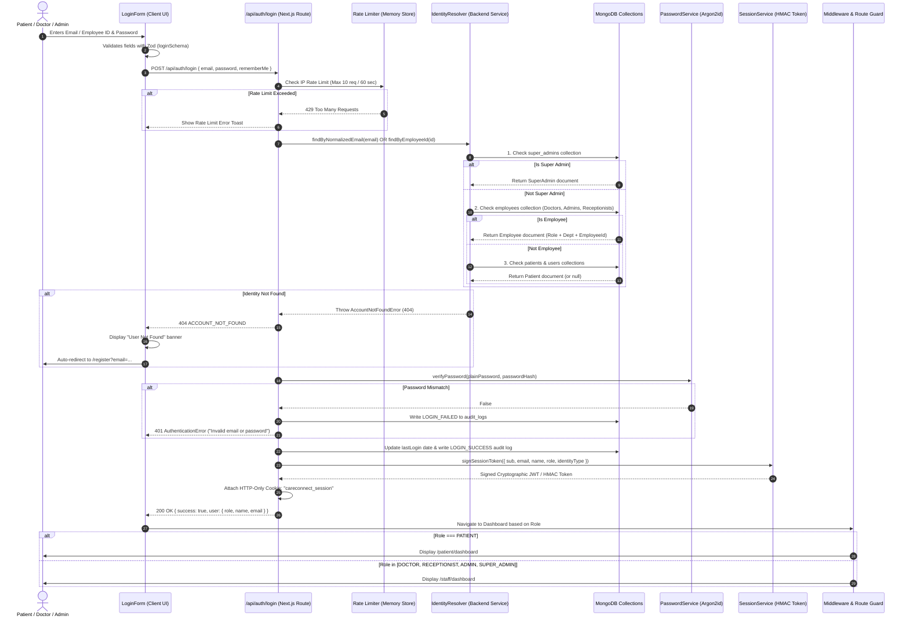

# 🏥 CareConnect - Smart Hospital OPD Queue & Appointment Management Platform

[](https://nextjs.org/)
[](https://react.dev/)
[](https://www.typescriptlang.org/)
[](https://www.mongodb.com/)
[](https://github.com/P-H-C/phc-winner-argon2)

CareConnect is a comprehensive, production-grade Hospital Outpatient Department (OPD) Queue and Appointment Coordination System. It streamlines the patient lifecycle from digital booking and walk-in front-desk triage, to doctor consultation queues, digital prescription generation, and automated role-based hospital administration.

---

## 📑 Table of Contents
1. [System Architecture & Technology Stack](#1-system-architecture--technology-stack)
2. [Authentication & Login Data Flow](#2-authentication--login-data-flow)
3. [Master Login Credentials Table](#3-master-login-credentials-table)
4. [Role-Based Access Control (RBAC) Matrix](#4-role-based-access-control-rbac-matrix)
5. [Core Modules & Operational Features](#5-core-modules--operational-features)
6. [Database Schema Overview](#6-database-schema-overview)
7. [Installation & Setup Guide](#7-installation--setup-guide)

---

## 1. System Architecture & Technology Stack

| Layer | Technology | Description |
|---|---|---|
| **Frontend Framework** | **Next.js 16 (App Router) + React 19** | Server & Client Components, Responsive Glassmorphism UI |
| **Language** | **TypeScript 7** | End-to-end strict type-safety across schema, API, and UI |
| **Styling & Icons** | **Tailwind CSS + Lucide React** | Modern clinical design system with fluid animations |
| **Database** | **MongoDB Atlas + Mongoose 9** | Scalable document store with relational index references |
| **Password Security** | **Argon2id (`@node-rs/argon2`)** | Memory-hard, GPU-resistant modern password hashing |
| **Session & Token** | **HMAC-SHA256 Signed Cookies** | HTTP-Only, Secure, SameSite protected `careconnect_session` |
| **Form Management** | **React Hook Form + Zod** | Client-side validation synchronized with backend schemas |
| **Notifications** | **Sonner** | Interactive toast notifications with role-aware status alerts |

---

## 2. Authentication & Login Data Flow

CareConnect implements a multi-tier identity resolution pipeline that automatically differentiates between **Super Admins**, **Hospital Staff (Doctors, Admins, Receptionists)**, and **Patients**, accepting either **Email Addresses** or **Employee IDs**.

### 2.1 Complete Authentication Sequence Diagram



### 2.2 Key Security Features of the Login Engine
1. **Identifier Auto-Detection**:
   - If the user enters an identifier without an `@` symbol (e.g., `DOC-2026-001` or `EMP-ADM-01`), the backend automatically treats it as an **Employee ID**.
   - If the user enters an email address, it normalizes casing and whitespace before matching.
2. **Argon2id Cryptographic Standard**:
   - Memory Cost: `65536 KB` (64 MB)
   - Time Cost: `3 iterations`
   - Parallelism: `4 threads`
   - Immune to GPU-accelerated brute-force attacks.
3. **HTTP-Only Session Management**:
   - The session token is stored strictly in an `httpOnly: true`, `sameSite: "lax"`, and `path: "/"` cookie named `careconnect_session`. JavaScript on the client cannot read the raw token, preventing XSS-based session hijacking.
4. **Smart "User Not Found" Redirection**:
   - If an unregistered email attempts to sign in, the backend responds with `ACCOUNT_NOT_FOUND` (404). The frontend detects this and smoothly redirects the user to `/register?email=...` with the email pre-populated for frictionless onboarding.
5. **Bidirectional Route Protection**:
   - A logged-in **Patient** attempting to access `/staff/dashboard` is intercepted and rerouted to `/patient/dashboard`.
   - A logged-in **Doctor or Staff member** attempting to access `/patient/dashboard` is rerouted to `/staff/dashboard`.

---

## 3. Master Login Credentials Table

All credentials below are pre-configured, verified, and ready for immediate testing.

### 🛡️ 3.1 Super Administrator Account
| Name | Role | Email | Employee ID | Password | Target Dashboard |
|---|---|---|---|---|---|
| Chief System Administrator | `SUPER_ADMIN` | `admin@gmail.com` | `N/A` | `Admin@123` | `/staff/dashboard` |

*Note: You can also use the one-click "Super Admin" auto-fill button directly on the `/login` page under the "Hospital Staff" tab.*

---

### 🏥 3.2 Hospital Administration (Admins)
| Name | Role | Email | Employee ID | Password | Department | Target Dashboard |
|---|---|---|---|---|---|---|
| Suresh Krishnan | `ADMIN` | `suresh.admin@careconnect.health` | `EMP-ADM-01` | `Password123!` | Administration | `/staff/dashboard` |
| Priya Ramanathan | `ADMIN` | `priya.ops@careconnect.health` | `EMP-ADM-02` | `Password123!` | Operations | `/staff/dashboard` |

---

### 🩺 3.3 Specialist Doctors (5 Clinical Departments)
*You can log in using either the **Email Address** OR the **Employee / Doctor ID** with the same password.*

| Doctor Name | Department | Specialization | Email | Doctor ID | Password | OPD Room |
|---|---|---|---|---|---|---|
| **Dr. Sarah Jenkins** | Cardiology | Interventional Cardiologist | `sarah.jenkins@careconnect.health` | `DOC-2026-001` | `Password123!` | Room 201 |
| **Dr. Rajesh Sundaram** | Neurology | Senior Neurologist | `rajesh.sundaram@careconnect.health` | `DOC-2026-002` | `Password123!` | Room 302 |
| **Dr. Vikram Sethi** | Orthopedics | Orthopedic Surgeon | `vikram.sethi@careconnect.health` | `DOC-2026-003` | `Password123!` | Room 105 |
| **Dr. Ananya Natarajan** | Pediatrics | Senior Pediatrician | `ananya.natarajan@careconnect.health` | `DOC-2026-004` | `Password123!` | Room 102 |
| **Dr. Arvind Swaminathan** | General Medicine | Chief Consultant Physician | `arvind.swaminathan@careconnect.health` | `DOC-2026-005` | `Password123!` | Room 101 |

---

### 📋 3.4 Front Desk & Reception Staff
| Name | Role | Email | Employee ID | Password | Operational Desk | Target Dashboard |
|---|---|---|---|---|---|---|
| Kavitha Murugan | `RECEPTIONIST` | `kavitha.reception@careconnect.health` | `EMP-REC-01` | `Password123!` | Front Desk & Triage | `/staff/dashboard` |
| Vignesh Balaji | `RECEPTIONIST` | `vignesh.triage@careconnect.health` | `EMP-REC-02` | `Password123!` | Emergency Triage Desk | `/staff/dashboard` |
| Deepa Senthil | `RECEPTIONIST` | `deepa.billing@careconnect.health` | `EMP-REC-03` | `Password123!` | Billing & Cashier Desk | `/staff/dashboard` |

---

### 👤 3.5 Registered Patient Accounts
| Patient Name | Blood Group | Gender | Registered Email | Password | Target Dashboard |
|---|---|---|---|---|---|
| Arunachalam Pillai | A+ | Male | `arunachalam@example.com` | `Password123!` | `/patient/dashboard` |
| Sneha Sundar | O+ | Female | `sneha.sundar@example.com` | `Password123!` | `/patient/dashboard` |
| Ramesh Kumar | B+ | Male | `ramesh.kumar@example.com` | `Password123!` | `/patient/dashboard` |
| Meenakshi Venkat | AB+ | Female | `meenakshi.v@example.com` | `Password123!` | `/patient/dashboard` |
| Karthik Subramaniam | O- | Male | `karthik.subbu@example.com` | `Password123!` | `/patient/dashboard` |

> 💡 **Google OAuth Alternative**: Patients can also click **"Continue with Google"** on `/login` or `/register` to instantly authenticate with their Google account.

---

## 4. Role-Based Access Control (RBAC) Matrix

| Feature / Action | `PATIENT` | `RECEPTIONIST` | `DOCTOR` | `ADMIN` | `SUPER_ADMIN` |
|---|:---:|:---:|:---:|:---:|:---:|
| **Book OPD Appointment** | ✅ | ✅ (Walk-in Desk) | ❌ | ✅ | ✅ |
| **View Own Live Token Status** | ✅ | ✅ | ✅ | ✅ | ✅ |
| **Cancel Own Appointment** | ✅ | ✅ | ❌ | ✅ | ✅ |
| **Confirm / Check-in Patient at Desk** | ❌ (Staff only) | ✅ | ✅ | ✅ | ✅ |
| **Reschedule / Change Appointment Time** | ❌ | ✅ | ✅ | ✅ | ✅ |
| **Call Next Patient in OPD Queue** | ❌ | ❌ | ✅ | ✅ | ✅ |
| **Write Clinical Prescription & Notes** | ❌ | ❌ | ✅ | ❌ | ✅ |
| **Issue Invoices & Collect Billing** | ❌ | ✅ | ❌ | ✅ | ✅ |
| **Add / Manage Doctors & Staff** | ❌ | ❌ | ❌ | ✅ | ✅ |
| **Modify Hospital Operational Settings** | ❌ | ❌ | ❌ | ❌ | ✅ |

---

## 5. Core Modules & Operational Features

### 1. Patient Portal (`/patient/dashboard`)
- **Direct OPD Booking**: Select specialist doctor, consultation date, and preferred slot.
- **Appointment Approval Workflow**: Once booked, ticket displays as **Pending Confirmation** until the hospital front-desk verifies and confirms check-in.
- **Live Queue Counter**: Displays your token number (e.g. `CARD-004`), doctor consultation room number, and current token being examined in real time.
- **Self-Service Cancellation**: Patients can safely cancel pending tickets without complex hurdles.

### 2. Hospital Reception Console (`/staff/dashboard`)
- **Appointment Verification & Desk Check-In**: Front desk receptionists confirm patient arrivals, issue physical queue tokens, or reschedule appointment timings.
- **Date & Department Filtering**: Live reactive filters by date and clinical department (Cardiology, Neurology, Orthopedics, Pediatrics, General Medicine).
- **Walk-in Triage**: Instant walk-in token generation for non-registered emergency patients.

### 3. Doctor Consultation Desk (`/staff/dashboard`)
- **OPD Queue Calling**: View active patient queue, mark "In Consultation", and call the next token.
- **Digital Rx Writer**: Enter clinical observations, vitals, diagnosis, medication dosages, and follow-up schedules.
- **Medical History Access**: Direct inspection of previous hospital visits and lab prescriptions.

### 4. Hospital & System Administration
- **Staff Roster Management**: Provision new doctors, assign department heads, and manage employee accounts.
- **Audit Trails**: Full system audit log recording all logins, token state transitions, and administrative overrides.

---

## 6. Database Schema Overview

```
careconnect/
├── super_admins        # System owner records (Argon2id password hashes)
├── employees           # Doctors, Hospital Admins, and Receptionists
├── patients            # Dedicated clinical patient records
├── users               # Shared user identities & OAuth linkages
├── departments         # Clinical departments (Cardiology, Neurology, etc.)
├── doctors             # Specialist doctor profiles, fees & schedules
├── appointments        # Scheduled bookings & desk check-in statuses
├── tokens              # Daily live OPD queue triage tokens
├── invoices            # Billing, consultation fees & receipt statuses
└── audit_logs          # Immutable security and access event logs
```

---

## 7. Installation & Setup Guide

### 7.1 Prerequisites
- **Node.js**: `v20.x` or `v22.x` / `v24.x`
- **npm**: `v10+`
- **MongoDB Atlas** or Local MongoDB instance

### 7.2 Environment Configuration
Create a `.env` file in the project root with the following keys:
```env
NODE_ENV="development"
MONGODB_URI="mongodb+srv://<username>:<password>@cluster0.uurxkmz.mongodb.net/careconnect?retryWrites=true&w=majority"
MONGODB_DB_NAME="careconnect"

APP_URL="http://localhost:3000"
NEXT_PUBLIC_APP_URL="http://localhost:3000"
NEXT_PUBLIC_APP_NAME="CareConnect"

# Session Security Secrets
AUTH_SECRET="5a17c012b5370cda4b04a44e4fc378ead973f61b2f8337ec72fd85ecb0392c68"
JWT_SECRET="5a17c012b5370cda4b04a44e4fc378ead973f61b2f8337ec72fd85ecb0392c68"

# Super Admin Initial Bootstrap
SUPER_ADMIN_NAME="Chief System Administrator"
SUPER_ADMIN_EMAIL="admin@gmail.com"
SUPER_ADMIN_INITIAL_PASSWORD="Admin@123"
```

### 7.3 Installation & Seeding Commands
```bash
# 1. Install dependencies
npm install

# 2. Provision initial Super Admin
npm run bootstrap:super-admin

# 3. Seed 5 Clinical Departments, 5 Doctors, 5 Staff, and 5 Patients
npm run seed:staff

# 4. Start Development Server
npm run dev
```

The web application will be live at `http://localhost:3000`.

---

© 2026 CareConnect Health Systems. All rights reserved.
