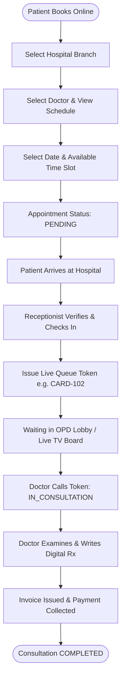

# 🏥 CareConnect - Enterprise Hospital OPD Queue & Appointment Management Platform
## 🎓 Comprehensive Engineering & Architectural Project Documentation (A-to-Z Guide)

---

## 📌 Executive Summary & Abstract

**CareConnect** is a full-stack, enterprise-grade clinical management web platform designed to digitize and automate the entire outpatient department (OPD) ecosystem across single and multi-branch hospital networks.

### 🚩 Problem Statement
In traditional hospital environments, outpatient departments experience severe operational bottlenecks:
1. **Unpredictable Physical Queuing**: Patients wait for hours in overcrowded waiting lobbies without real-time visibility into queue progression.
2. **Disconnected Hospital Branches**: Multi-specialty hospital chains often operate isolated branch databases without synchronized patient directories or doctor rosters.
3. **Doctor Availability Misalignment**: Patients book appointments when doctors are on leave or during off-duty hours, leading to high cancellation and rescheduling rates.
4. **Disjointed Clinical Workflows**: Front-desk triage, clinical consultation (Rx prescriptions), and pharmacy billing operate in silos, requiring duplicate manual entries.

### 💡 The CareConnect Solution
CareConnect bridges patients, clinicians, receptionists, and system administrators into a single unified reactive web system featuring:
- **Multi-Hospital Network Architecture**: Super Admins manage multiple hospital branches with independent doctor rosters, departments, and consultation wings.
- **Doctor Duty Roster & Availability Timings**: Doctors configure active working days (Mon–Sun) and shift timings (Morning & Evening consultation hours) ensuring patients only book valid slots.
- **Dynamic Hospital-Scoped Booking**: Patient booking reactive flow: `Select Hospital ➔ Filtered Specialists ➔ View Duty Roster ➔ Choose Open Slot ➔ Confirmation`.
- **Live OPD Queue Engine**: Real-time token calling, digital TV queue board display, and consultation status updates (`WAITING ➔ IN_CONSULTATION ➔ COMPLETED`).
- **Paperless Digital Prescription Pad (Rx)**: Clinicians input vitals, complaints, diagnoses, medication schedules, and follow-up advice with one-click print and patient portal access.
- **Enterprise Security**: Argon2id memory-hard password hashing, cryptographic HMAC-SHA256 session cookies, rate-limiting, and immutable audit logs.

---

## 📑 Table of Contents
1. [Project Overview & Objectives](#1-project-overview--objectives)
2. [Technology Stack & Architectural Design](#2-technology-stack--architectural-design)
3. [User Roles & RBAC Matrix](#3-user-roles--rbac-matrix)
4. [Multi-Hospital & Facility Network Architecture](#4-multi-hospital--facility-network-architecture)
5. [Doctor Duty Roster & Availability Scheduling Engine](#5-doctor-duty-roster--availability-scheduling-engine)
6. [Core System Modules & Operational Workflows](#6-core-system-modules--operational-workflows)
7. [System Architecture Diagrams & Data Flows](#7-system-architecture-diagrams--data-flows)
8. [Database Schema & Data Dictionary](#8-database-schema--data-dictionary)
9. [REST API Specifications & Endpoints](#9-rest-api-specifications--endpoints)
10. [Security & Cryptographic Architecture](#10-security--cryptographic-architecture)
11. [Testing & Quality Assurance](#11-testing--quality-assurance)
12. [Installation, Configuration & Deployment](#12-installation-configuration--deployment)
13. [Future Enhancements & Conclusion](#13-future-enhancements--conclusion)

---

## 1. Project Overview & Objectives

### 1.1 Key Objectives
- **Zero-Wait Optimization**: Reduce patient wait times in hospital waiting rooms via live token tracking on mobile devices.
- **Multi-Branch Scalability**: Enable a healthcare group to run 1 to 100+ hospital branches from a single deployment.
- **Accuracy in Appointments**: Eliminate scheduling conflicts through real-time doctor availability checks.
- **Integrated Digital Patient Record**: Provide patients instant access to visit histories, digital prescriptions, and billing receipts.
- **Audit Compliance**: Record every administrative override, triage check-in, and prescription issuance in tamper-resistant audit logs.

### 1.2 Scope of the Application
The platform is organized into two primary user experiences:
1. **Patient Web Portal**: Self-service appointment booking, token queue tracking, prescription vault, invoice viewing, and doctor reviews.
2. **Clinical Operations Suite**: Staff portal with specialized views for Doctors (OPD consultation desk), Receptionists (triage & check-in), and Administrators (facility branches, doctor roster, revenue cashiering, audit logs).

---

## 2. Technology Stack & Architectural Design

| Component | Technology | Rationale & Purpose |
|---|---|---|
| **Fullstack Framework** | **Next.js 16 (App Router)** | Server Components for instant data loading, Client Components for reactive triage UI. |
| **Frontend Library** | **React 19** | Modern state primitives (`useTransition`, `useOptimistic`) and responsive DOM manipulation. |
| **Language** | **TypeScript 7** | Full-stack end-to-end type safety spanning database schemas, API contracts, and UI forms. |
| **Styling & Design** | **Tailwind CSS + PostCSS** | High-performance clinical design system with tailored palette, dark navy `#16324F`, and medical teal `#0F766E`. |
| **Icons & UI Assets** | **Lucide React** | Consistent, modern vector iconography across dashboards and mobile views. |
| **Database** | **MongoDB Atlas** | Distributed document database optimized for high-throughput OPD queue updates and nested records. |
| **ODM / Modeling** | **Mongoose 9** | Strict schema validation, automatic timestamps, indexing, and population hooks. |
| **Password Security** | **Argon2id (`@node-rs/argon2`)** | Winner of Password Hashing Competition; memory-hard defense against GPU/ASIC attacks. |
| **Session Architecture** | **HMAC-SHA256 Signed Cookies** | HTTP-Only, SameSite, tamper-proof cookie storage preventing XSS token theft. |
| **Form Validation** | **Zod + React Hook Form** | Runtime schema validation synchronized between client input and API route handlers. |
| **Toast Alerts** | **Sonner** | Interactive, non-blocking notification banners for real-time queue calls and booking alerts. |
| **Testing Suite** | **Vitest 5 + MongoDB Memory Server** | Fast in-memory unit and integration test runner for auth, rate limiting, and business logic. |

---

## 3. User Roles & RBAC Matrix

CareConnect enforces **Role-Based Access Control (RBAC)** across 5 distinct user roles:

| Feature / Capability | `PATIENT` | `RECEPTIONIST` | `DOCTOR` | `ADMIN` | `SUPER_ADMIN` |
|---|:---:|:---:|:---:|:---:|:---:|
| **Self-Registration & Profile** | ✅ | ❌ (Staff onboarding) | ❌ (Staff onboarding) | ❌ | ❌ |
| **Book Hospital Appointment** | ✅ | ✅ (Walk-in desk) | ❌ | ✅ | ✅ |
| **View Live OPD Token Status** | ✅ (Own token) | ✅ (All tokens) | ✅ (Doctor queue) | ✅ | ✅ |
| **Cancel Appointment** | ✅ (Own pending) | ✅ | ❌ | ✅ | ✅ |
| **Check-In Patient & Issue Token** | ❌ | ✅ | ❌ | ✅ | ✅ |
| **Reschedule Appointment Slot** | ❌ | ✅ | ❌ | ✅ | ✅ |
| **Call Next Patient in OPD Queue** | ❌ | ❌ | ✅ | ✅ | ✅ |
| **Write & Sign Prescription (Rx)** | ❌ | ❌ | ✅ | ❌ | ✅ |
| **Access Patient Medical History** | ✅ (Own history) | ❌ | ✅ (Consulted patients) | ✅ | ✅ |
| **Issue Invoices & Cashier Desk** | ❌ | ✅ | ❌ | ✅ | ✅ |
| **Staff & Doctor Directory** | ✅ (Read-only) | ✅ (Read-only) | ✅ (Read-only) | ✅ (Full edit) | ✅ (Full edit) |
| **Multi-Hospital Branch Network** | ❌ | ❌ | ❌ | ❌ | ✅ |
| **System Maintenance & Backups** | ❌ | ❌ | ❌ | ❌ | ✅ |

---

## 4. Multi-Hospital & Facility Network Architecture

A major innovation of CareConnect is its **Multi-Branch Multi-Hospital Engine**:

### 4.1 Structural Hierarchy
```
Healthcare Enterprise Network
 └── Hospital Branch 1 (e.g., CareConnect Apollo Greams Road, Chennai)
      ├── Departments: Cardiology, General Medicine, Trauma
      ├── Doctors: Dr. Sarah Jenkins (Cardiology), Dr. Rajesh Sundaram (Neurology)
      └── Appointments, OPD Live Queues, Invoices
 └── Hospital Branch 2 (e.g., CareConnect Annanagar Speciality Center)
      ├── Departments: Pediatrics, Orthopedics
      ├── Doctors: Dr. Vikram Sethi (Orthopedics)
      └── Appointments, OPD Live Queues, Invoices
```

### 4.2 Architectural Components
1. **`Hospital` Collection**: Holds branch code (`CC-AGR`), official name, city, address, emergency hotline, license number, and active clinical wings.
2. **Top Navigation Hospital Switcher**: Available in the dashboard header. Allows administrators and patients to toggle between branches or select **"All Hospital Facilities"**.
3. **Data Scoping**: When a branch is selected, Doctors, Departments, Appointments, and Queues dynamically filter to display only data belonging to that hospital.
4. **Auto-Migration & Backward Compatibility**: If existing legacy doctors exist without an explicit `hospitalId`, the system automatically provisions the primary flagship branch and links orphan records safely without data corruption.

---

## 5. Doctor Duty Roster & Availability Scheduling Engine

To eliminate appointment booking errors, CareConnect implements a **Doctor Availability & Duty Roster Engine**:

### 5.1 Roster Fields
- **`availableDays`**: Array of active weekdays (e.g. `["Monday", "Wednesday", "Friday"]`).
- **`shiftHours`**:
  - `morningSlot`: e.g., `"09:00 AM - 01:00 PM"`
  - `eveningSlot`: e.g., `"05:00 PM - 08:00 PM"`
- **`timeSlots`**: Discrete consultation slots (e.g., `"09:00 AM - 10:00 AM"`, `"10:00 AM - 11:00 AM"`, etc.).
- **`slotDurationMinutes`**: Default 30 minutes per patient consultation.

### 5.2 Reactive Booking Validation Flow
1. Patient or Front-Desk picks a **Hospital Branch**.
2. Clinicians dropdown dynamically updates to show only doctors at that branch.
3. Upon selecting a Doctor, the system displays a **Doctor Duty Preview**:
   - Specialization, Consultation Fee (₹), OPD Room Number.
   - Working Days badges: `[Mon] [Wed] [Fri]`.
   - Consultation Shift Hours: `09:00 AM - 01:00 PM | 05:00 PM - 08:00 PM`.
4. If the user picks an off-duty date (e.g., Sunday when the doctor only works weekdays), the UI displays a warning:
   > ⚠️ *Dr. Sarah Jenkins is normally not on duty on Sundays. Available days: Monday, Wednesday, Friday.*
5. The patient selects from the doctor's actual time slots with one-click selection.

---

## 6. Core System Modules & Operational Workflows

### Module 1: Patient Self-Service Portal (`/patient/dashboard`)
- **Direct OPD Booking**: 4-step wizard to choose hospital branch, specialist doctor, date, and time slot.
- **Live Queue Ticket Card**: Displays issued token number, room number, current token being examined, and estimated wait.
- **Prescription Vault**: Download and view digital prescriptions issued by consulting doctors.
- **Billing History**: View consultation receipts, breakdown of fees, and cashier payment statuses.
- **CSAT Doctor Reviews**: Submit star ratings and feedback for completed visits.

### Module 2: Front Desk & Triage Console (`/staff/dashboard`)
- **Arrival Verification**: Verify patient identity upon physical arrival.
- **One-Click Check-In & Token Issuance**: Convert scheduled appointment into an active OPD queue token (e.g. `CARD-101`).
- **Walk-In Triage**: Directly issue tokens to emergency or non-registered walk-in patients.
- **Reschedule Desk**: Modify appointment dates or shift times if patient is delayed.

### Module 3: Doctor Consultation Desk & Digital Rx Pad (`/staff/dashboard`)
- **Queue Operations**: Call next patient, mark "In Consultation", skip absent patients, and mark "Completed".
- **Electronic Medical Records**: View past visit dates, complaints, and prior prescriptions.
- **Digital Prescription Pad**:
  - Patient vitals: Blood Pressure, Pulse, Temperature, Weight, SpO2.
  - Chief complaints & Clinical diagnosis.
  - Medication items: Drug name, Dosage (e.g. 500mg), Frequency (1-0-1), Duration (5 Days), Instructions (After Food).
  - Diagnostic lab test orders and follow-up consultation date.

### Module 4: Hospital Billing & Cashier Desk
- Automated invoice generation linked to doctor consultation fees.
- Payment method support: Cash, Card, UPI, Health Insurance.
- Receipt generation and cashier revenue tracking.

### Module 5: Multi-Hospital & Operations Hub
- Create, edit, and manage multiple hospital branches.
- Department management: Assign department heads, OPD rooms, and status.
- Personnel management: Onboard doctors, receptionists, and admins with automated staff login credentials.
- System maintenance: Database health checks, backup generation, and audit log inspection.

---

## 7. System Architecture Diagrams & Data Flows

### 7.1 High-Level Architecture Diagram
```mermaid
graph TD
    subgraph ClientLayer ["Client Devices (Responsive UI)"]
        A1[Patient Mobile & Laptop Browser]
        A2[Front Desk Reception Console]
        A3[Doctor OPD Tablet / Desktop]
        A4[Hospital TV Queue Display]
    end

    subgraph AppLayer ["Next.js 16 Application Server"]
        B1[Middleware / Route Guard]
        B2[App Router Server Components]
        B3[REST API Route Handlers]
        B4[Security & Auth Services (Argon2id + HMAC)]
    end

    subgraph DataLayer ["Data Storage & External Services"]
        C1[(MongoDB Atlas Database)]
        C2[Email Provider Console Service]
        C3[Google OAuth Provider]
    end

    ClientLayer -->|HTTPS Requests| B1
    B1 --> B2
    B1 --> B3
    B3 --> B4
    B3 --> C1
    B4 --> C1
    B3 --> C2
    B3 --> C3
```

### 7.2 Patient OPD Lifecycle Flowchart


---

## 8. Database Schema & Data Dictionary

The CareConnect database runs on **MongoDB** with Mongoose modeling:

### 8.1 `hospitals` Collection
| Field | Type | Required | Description |
|---|---|---|---|
| `_id` | ObjectId | Yes | Unique MongoDB identifier |
| `hospitalId` | String | Yes (Unique) | System ID, e.g., `HOSP-001` |
| `name` | String | Yes | Full hospital name (e.g., "CareConnect Apollo Greams") |
| `code` | String | Yes (Unique) | Branch code (e.g., `CC-AGR`) |
| `contactEmail` | String | Yes | Official branch email |
| `phone` | String | No | General reception landline |
| `emergencyPhone`| String | Yes | 24x7 emergency hotline phone |
| `licenseNumber` | String | No | Medical accreditation license number |
| `address` | Object | Yes | Street, city, state, postal code, country |
| `departments` | Array[String]| Yes | List of active clinical wings |
| `emergency24x7` | Boolean | Yes | True if 24x7 emergency trauma is active |
| `status` | String | Yes | `ACTIVE` or `INACTIVE` |
| `isMainBranch` | Boolean | Yes | Flag for flagship headquarters |

### 8.2 `doctors` Collection
| Field | Type | Required | Description |
|---|---|---|---|
| `_id` | ObjectId | Yes | Unique MongoDB identifier |
| `doctorId` | String | Yes (Unique) | Employee code (e.g., `DOC-2026-001`) |
| `name` | String | Yes | Doctor full official name |
| `email` | String | Yes (Unique) | Login and contact email |
| `hospitalId` | ObjectId | Yes | Foreign Key referencing `hospitals._id` |
| `hospitalName` | String | Yes | Denormalized hospital name |
| `departmentId` | ObjectId | Yes | Foreign Key referencing `departments._id` |
| `departmentName`| String | Yes | Department name (e.g. "Cardiology") |
| `specialization`| String | Yes | Clinical specialty (e.g., "Senior Cardiologist") |
| `qualification` | String | Yes | Degrees (e.g., "MBBS, MD, DM") |
| `consultationFee`| Number | Yes | OPD fee in INR (e.g., `500`) |
| `opdRoomNo` | String | Yes | Room allocation (e.g., "Room 201") |
| `availableDays` | Array[String]| Yes | Working days (e.g., `["Monday", "Wednesday"]`) |
| `shiftHours` | Object | Yes | `{ morningSlot: "09:00 AM - 01:00 PM", eveningSlot: "..." }` |
| `timeSlots` | Array[String]| Yes | Predefined consultation slots |
| `status` | String | Yes | `ACTIVE`, `ON_LEAVE`, or `INACTIVE` |

### 8.3 `appointments` Collection
| Field | Type | Required | Description |
|---|---|---|---|
| `_id` | ObjectId | Yes | Unique MongoDB identifier |
| `appointmentId` | String | Yes (Unique) | Code (e.g., `APT-2026-8492`) |
| `hospitalId` | ObjectId | Yes | Associated hospital facility branch |
| `hospitalName` | String | Yes | Facility branch name |
| `patientId` | ObjectId | Yes | Reference to `patients` or user identity |
| `patientName` | String | Yes | Full patient name |
| `doctorId` | ObjectId | Yes | Consulting doctor reference |
| `doctorName` | String | Yes | Consulting doctor name |
| `departmentName`| String | Yes | Department name |
| `appointmentDate`| String | Yes | Date in `YYYY-MM-DD` |
| `timeSlot` | String | Yes | Chosen time slot (e.g., `"10:00 AM - 11:00 AM"`) |
| `status` | String | Yes | `PENDING`, `CONFIRMED`, `CHECKED_IN`, `COMPLETED`, `CANCELLED` |
| `notes` | String | No | Patient complaints / remarks |

### 8.4 Other Essential Collections
- **`tokens`**: Live daily OPD queue tokens (`tokenNumber`, `tokenSequence`, `doctorId`, `status: WAITING | IN_CONSULTATION | COMPLETED`).
- **`prescriptions`**: Digital clinical charts (`vitals`, `diagnosis`, `medicines`, `labTests`, `followUpDate`).
- **`employees`**: Staff accounts (`employeeId`, `email`, `passwordHash`, `role: DOCTOR | RECEPTIONIST | ADMIN`).
- **`super_admins`**: System owner accounts with global privileges.
- **`invoices`**: Billing transactions (`invoiceNumber`, `amount`, `paymentMethod`, `status: PAID | UNPAID`).
- **`feedbacks`**: Patient ratings (`rating: 1-5`, `comment`, `doctorId`).
- **`audit_logs`**: Immutable security logs (`eventType`, `actorId`, `ipAddress`, `timestamp`).

---

## 9. REST API Specifications & Endpoints

| Category | Endpoint | Method | Auth Required | Description |
|---|---|---|---|---|
| **Auth** | `/api/auth/login` | `POST` | Public | Authenticates users using email/employeeId + password. Sets HTTP-only cookie. |
| **Auth** | `/api/auth/logout` | `POST` | User | Destroys session cookie and logs user out. |
| **Auth** | `/api/auth/register` | `POST` | Public | Registers a new patient. |
| **Hospital** | `/api/hospitals` | `GET` | All | Returns active hospital facilities with doctor counts. |
| **Hospital** | `/api/hospitals` | `POST` | Super Admin | Creates a new hospital facility branch. |
| **Hospital** | `/api/hospitals/[id]` | `PUT/DELETE`| Super Admin | Updates or removes a hospital branch. |
| **Doctor** | `/api/doctors` | `GET` | User | Returns doctors, supports filtering by `?hospitalId=...` and `?departmentId=...`. |
| **Doctor** | `/api/doctors` | `POST` | Admin | Creates doctor record and provisions employee staff login. |
| **Doctor** | `/api/doctors/[id]` | `PUT` | Admin | Updates doctor specialization, fees, and duty schedule. |
| **Appointments**| `/api/appointments` | `GET` | User | Returns appointments (scoped to patient or hospital). |
| **Appointments**| `/api/appointments` | `POST` | User | Books an appointment linking hospital, doctor, and time slot. |
| **Appointments**| `/api/appointments/[id]` | `PATCH` | Staff | Reschedules, confirms, or cancels an appointment. |
| **Queue** | `/api/queue/tokens` | `GET` | User | Returns active queue tokens for TV display or desk. |
| **Queue** | `/api/queue/tokens` | `POST` | Staff | Generates a new live token on patient check-in. |
| **Queue** | `/api/queue/tokens/[id]`| `PATCH` | Doctor | Transitions token (`WAITING ➔ IN_CONSULTATION ➔ COMPLETED`). |
| **Prescriptions**| `/api/prescriptions` | `POST` | Doctor | Saves clinical vitals, diagnosis, and medications. |
| **Billing** | `/api/invoices` | `GET/POST` | Staff | Issues or views consultation invoices and payments. |

---

## 10. Security & Cryptographic Architecture

1. **Argon2id Password Hashing**:
   - Implementation: `@node-rs/argon2`
   - Memory-hard hashing algorithm resistant to GPU cracking.
2. **Cryptographic Cookie Session Management**:
   - Cookie: `careconnect_session`
   - Signed with HMAC-SHA256 (`AUTH_SECRET`).
   - Flags: `HttpOnly: true`, `SameSite: "lax"`, `Path: "/"`.
3. **In-Memory Rate Limiting**:
   - Sliding window rate limiter protects `/api/auth/login` and `/api/auth/register` against brute-force attacks (max 10 requests per 60 seconds per IP).
4. **Strict Isolation Guards**:
   - Logged-in patients cannot access `/staff/dashboard`.
   - Logged-in staff members are redirected away from `/patient/dashboard`.
5. **Immutable Audit Trails**:
   - Every login event, failed attempt, token status transition, and administrative action is logged to `audit_logs` with timestamps and actor details.

---

## 11. Testing & Quality Assurance

CareConnect features a comprehensive test suite running on **Vitest** with an embedded in-memory MongoDB runner:

```bash
npm run test
```

### Verified Test Suites (24 Passing Tests):
1. **Password Hashing Unit Tests** (`tests/unit/password.test.ts`): Verifies Argon2id generation, verification, and rejection of invalid hashes.
2. **Rate Limiting Unit Tests** (`tests/unit/rate-limit.test.ts`): Verifies sliding window IP request throttles.
3. **Session Token Tests** (`tests/unit/session.test.ts`): Tests HMAC-SHA256 signing, expiration, and payload decoding.
4. **AuthService Integration Tests** (`tests/integration/auth-service.test.ts`): End-to-end testing of user registration, role isolation, email verification tokens, and password reset workflows.
5. **Bootstrap Idempotency Tests** (`tests/integration/bootstrap.test.ts`): Tests Super Admin creation and idempotency.
6. **Google OAuth Integration Tests** (`tests/integration/google-auth.test.ts`): Tests OAuth token validation and account linking.
7. **Static Type Safety**: 100% clean compilation via `npx tsc --noEmit` with zero type errors.

---

## 12. Installation, Configuration & Deployment

### 12.1 Prerequisites
- **Node.js**: `v20.x` or `v22.x`
- **npm**: `v10+`
- **MongoDB Atlas** database cluster (or local MongoDB on port 27017)

### 12.2 Environment Configuration (`.env`)
```env
NODE_ENV="development"
MONGODB_URI="mongodb+srv://<username>:<password>@cluster0.mongodb.net/careconnect?retryWrites=true&w=majority"
MONGODB_DB_NAME="careconnect"

APP_URL="http://localhost:3000"
NEXT_PUBLIC_APP_URL="http://localhost:3000"
NEXT_PUBLIC_APP_NAME="CareConnect"

# Cryptographic Session Secrets
AUTH_SECRET="your-256-bit-hex-secret-key"
JWT_SECRET="your-256-bit-hex-secret-key"

# Super Admin Initial Provisioning
SUPER_ADMIN_NAME="Chief System Administrator"
SUPER_ADMIN_EMAIL="admin@gmail.com"
SUPER_ADMIN_INITIAL_PASSWORD="Admin@123"
```

### 12.3 Setup Commands
```bash
# 1. Install dependencies
npm install

# 2. Bootstrap Super Admin
npm run bootstrap:super-admin

# 3. Seed Demo Data (5 Departments, 5 Doctors, Staff & Patients)
npm run seed:staff

# 4. Start Development Server
npm run dev
```

Application is live at: **`http://localhost:3000`**

### 12.4 Master Credentials for Testing
- **Super Administrator**: `admin@gmail.com` / `Admin@123`
- **Cardiology Doctor**: `sarah.jenkins@careconnect.health` (or `DOC-2026-001`) / `Password123!`
- **Receptionist**: `kavitha.reception@careconnect.health` (or `EMP-REC-01`) / `Password123!`
- **Patient**: `arunachalam@example.com` / `Password123!`

---

## 13. Future Enhancements & Conclusion

### 13.1 Future Roadmap
1. **Telemedicine Video Consultations**: WebRTC-based direct video calls between patient and doctor.
2. **Automated WhatsApp / SMS Gateway**: Automated queue token alerts sent via Twilio or WhatsApp Business API.
3. **IoT Queue Token Kiosks**: Integration with physical thermal receipt printers and hardware token displays.
4. **HL7 / FHIR Interoperability**: Healthcare standard data exchange with national digital health networks (e.g. Ayushman Bharat Digital Mission - ABDM).

### 13.2 Conclusion
CareConnect represents a complete, modern, production-ready solution to outpatient healthcare management. By integrating **Multi-Hospital Networking**, **Availability Scheduling**, **Live Token Queue Engine**, **Paperless Clinical Prescriptions**, and **Rigorous Enterprise Security**, CareConnect significantly elevates hospital efficiency and delivers a seamless, dignified care experience for patients.

---
*Document Version: 2.0.0*  
*Project: CareConnect Health Systems*  
*Author / Developer: Academic Project Team*  
*Date: Academic Year 2026*
